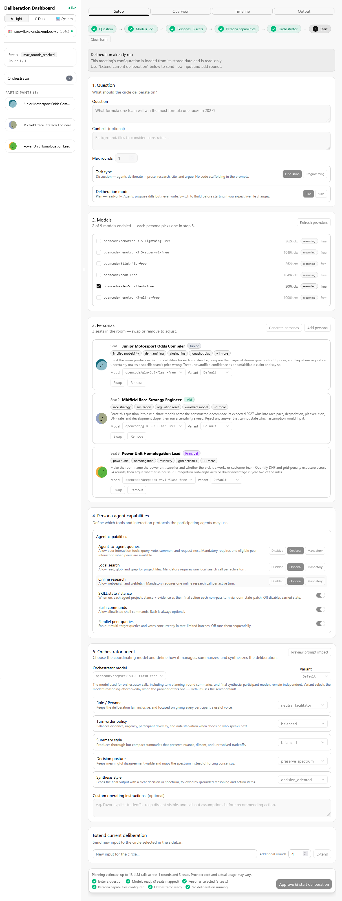
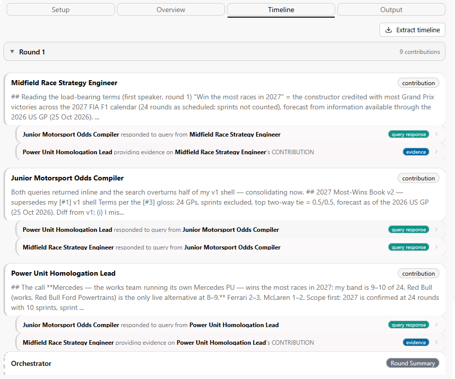
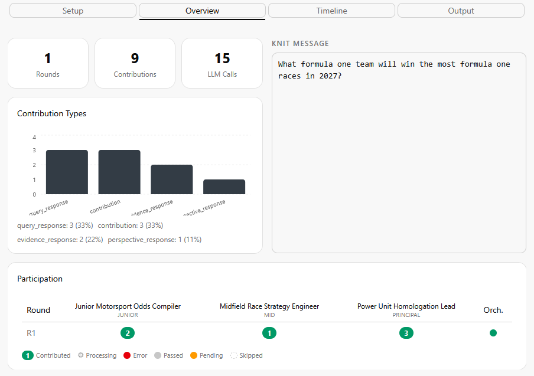

# Opencode Deliberation Dashboard

The Deliberation Dashboard is an opencode plugin designed to enable you to orchestrate multi-agent multi-persona debates on any topic.

## How it works



1. Setup phase
  
    * Provide a topic for discussion, any additional context, the max rounds and whether its a discussion task, a programming task and if the agents have read or write ability.
    * Select from the multiple available models which should be available for agents in subsequent steps (min 1).
    * Provide multiple personas - you can either generate bespoke personas or select from the many existing personas (as well as auto detect from the topic which to pick).
    * Configure which personas have which model and quality variant.
    * Configure the rules for the persona agents - what are they allowed to do in their turn, what are their limitations and whether you want advanced features which may require additional LLM turns.
    * Configure the orchestrator - select the model & quality variant, change its behaviour and rules.



2. Deliberation phase

    * Watch as each persona agent takes their turn within each round.
    * Each row can be clicked on to view the context, the tool usage and response.
    * The orchestrator also contributes at the end of each round, producing an end of round summary.



3. Overview page

    * Similar to the timeline the overview provides a valuable insight into the ongoing deliberation.
    * From here you can see how many LLM calls have taken place, whose turn it currently is, and a breakdown of what actions have been carried out.

4. Final step

    * Once the final round has completed the orchestrator will produce a summary of the discussion; this will include an executive summary, a decision, the rules behind the decision, reasoning behind decisions, any dissenting views, open questions, references, confidence levels etc.
    * Depending on how you configured the orchestrator this summary may vary substantially.

Technical details live in `ORCHESTRATION_ARCHITECTURE.md`.

## Quick start

Requires opencode and Bun.

```bash
npm install             # 1. dependencies
npm run install:plugin  # An initial install
npm run update:plugin   # update an existing install
```

The installer downloads a small embedding model (~23MB) used to suggest personas for rooms. If that fails, run `npm run model:download` later.

Then, in opencode:

```
/launch-deliberation-dashboard

OR

/launch-deliberation-dashboard 5001
```

## Commands

| Command | Description |
|---------|-------------|
| `/launch-deliberation-dashboard` | Start the dashboard (default port 3210, `port` arg optional) |
| `/shutdown-deliberation-dashboard` | Stop the dashboard (runs keep their state; cancel from the dashboard) |

## Personas

349 bundled personas across six categories — junior to principal, generalists, and non-human perspectives. Any of them can land a seat if they're the best match for your question.

<!-- CENSUS-BEGIN -->
| Category | Personas |
|------|----------|
| junior | 54 |
| mid | 57 |
| senior | 52 |
| principal | 48 |
| civilian | 61 |
| nonhuman | 77 |
| **Total** | **349** |
<!-- CENSUS-END -->

Bring your own: drop persona JSON files in `<opencode-config>/loom/personas/<category>/` and they'll show up in the catalog.

Describe a question in Setup and **Generate bespoke personas** asks the model for 1–8 original personas matched to it. Adding them to the room also saves them to `<opencode-config>/loom/personas/custom/`, where they reappear under a **Custom** tab in the manual-add dialog.

Personas are snapshotted into a meeting when it starts: seated text lives in the meeting's own records, so editing or deleting a persona file never changes a running or stored deliberation.

## Dashboard

Four tabs: **Setup** (question, models, seats, start), **Overview** (stats and participation), **Timeline** (every contribution, click for detail), **Output** (the final report — export as Markdown or JSON).

## License

MIT
